<p align="center">
  
</p>

<p align="center">
  
</p>

<p align="center">
  
  
  
  
  
  
  
</p>

---

## 🔮 Experience Local Audio in Cyber-Glass Aesthetics

**Looper for Android** is a native, offline-first, high-fidelity local music player engineered completely from the ground up using **Kotlin**, **Jetpack Compose**, and **AndroidX Media3 (ExoPlayer)**.

It pairs an audio engine with a **Glassmorphic / Neo-Blur** interface that extracts dynamic color palettes from your album artwork in real time. Designed with a strict **offline-first, zero-telemetry** philosophy, your audio files, playlists, lyrics, and configurations stay exclusively on your device.

---

## 🚀 Key Features

```
┌────────────────────────────────────────────────────────────────────────┐
│                        LOOPER ANDROID FEATURES                         │
├───────────────────────────────────────┬────────────────────────────────┤
│ 🔮 GLASSMORPHIC CYBER-UI              │ ⚡ MEDIA3 / EXOPLAYER AUDIO   │
│   Real-time blur, glow borders, and   │   Bit-perfect gapless playback,│
│   dynamic palette extraction.         │   audio focus & lockscreen sync│
├───────────────────────────────────────┼────────────────────────────────┤
│ 🧩 INTERACTIVE GLANCE WIDGET SUITE    │ 🎤 SYNCHRONIZED LRC LYRICS     │
│   5 dynamic home screen widgets:      │   Real-time smooth scrolling,  │
│   Mini, Classic, Art, Square & Lyrics!│   tap-to-seek & LRCLIB sync.   │
├───────────────────────────────────────┼────────────────────────────────┤
│ 🎚️ 18-BAND GRAPHIC EQUALIZER         │ 🔒 100% PRIVATE & OFFLINE      │
│   Custom curve shaping, dB grids,     │   Zero telemetry, no trackers, │
│   bass boost & zero-snapping.         │   no cloud accounts required.  │
└───────────────────────────────────────┴────────────────────────────────┘
```

### 🎨 Material 3 Expressive & Neo-Blur Aesthetics
- **Dynamic Palette Morphing**: Ambient background glows, button highlights, progress sliders, and frosted glass cards adapt to match the album artwork of the playing track with smooth crossfade animations.
- **Glassmorphic Surfaces**: Custom blur backdrops and translucent borders provide depth and modern visual hierarchy across standard, tall, and foldable screens.

### 🧩 Interactive AndroidX Glance Widget Suite
Looper features a collection of home screen widgets built using AndroidX Glance (Compose for AppWidgets):
- **Mini Capsule Widget**: A compact pill widget featuring essential controls (Play/Pause, Previous, Next), title/artist marquee, dynamic color adaptation, optional border outlines, and matching album corner radii.
- **Classic Widget**: An expanded media card showing high-resolution album artwork, seek progress bar, and full transport controls.
- **Square Widget**: A balanced layout that intelligently scales album art as the widget is resized on your home screen grid.
- **Synchronized Lyrics Widget**: Live lyrics directly on your Android launcher! Dynamically expands from **3 lines to 5 lines** when stretched vertically, featuring centered active lyric lines and tap-to-open actions.
- **In-App Widget Customizer**: Real-time interactive preview screen to fine-tune widget transparency (0% to 100%), border outlines, corner radii, and favorite button toggles.

### 🎤 Synchronized LRC Lyrics
- **Real-time Karaoke Scrolling**: Fluid line-by-line animations synchronized with playback progress.
- **Tap-to-Seek**: Jump straight to any section of the song simply by tapping a lyric line.
- **Offline & Online Sources**: Automatically loads embedded and local `.lrc` files, or fetches synchronized lyrics on-demand via [LRCLIB](https://lrclib.net/).
- **Customizable Experience**: Supports font scaling, translation toggle, and display keep-awake modes.

### ⚡ Media3 & ExoPlayer Engine
- **Gapless Audio & Fade Transitions**: Smooth playback transitions without audio pops or stuttering.
- **Intelligent Audio Focus**: Seamlessly handles phone calls, navigation prompts, and transient audio ducking with customizable resume behaviors.
- **Background Persistence**: Native Android `MediaSessionService` ensures stable background playback that persists even when the app is swiped away from Recents.
- **Timeline & Queue Recovery**: Remembers your active queue and exact playback timestamp down to the millisecond across app restarts.

### 🎚️ 18-Band Equalizer & Sound Effects
- Multi-band graphical equalizer with curve manipulation, decibel scale guidelines (+/- 20 dB), frequency adjustment bands (65Hz to 20kHz), zero-snapping, and instant preset selection.

---

## 📸 Screenshots

### 📱 Now Playing & Synchronized Lyrics
<p align="center">
  
  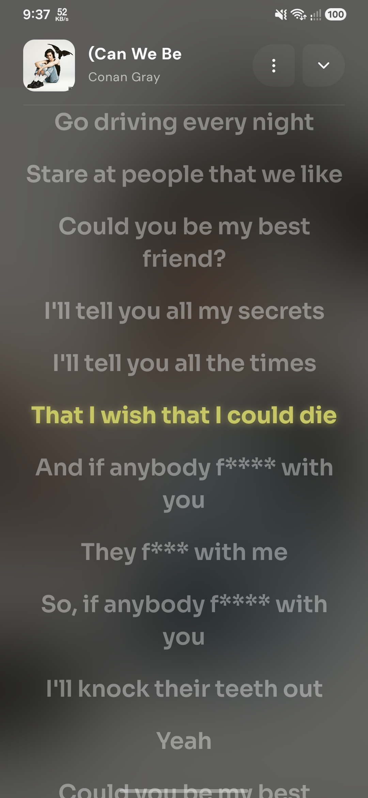
  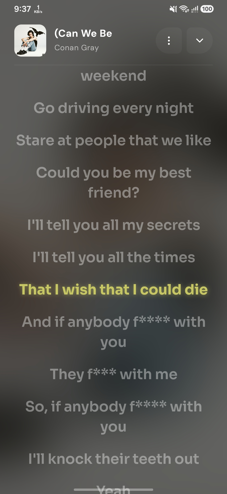
  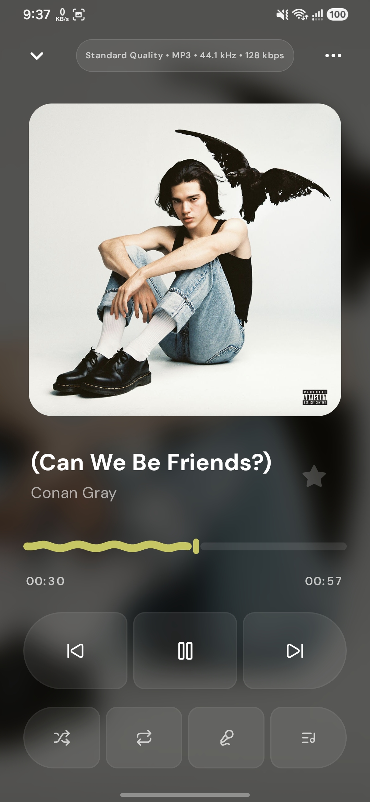
</p>

### 🎨 Real-time Dynamic Theming & Neo-Blur
<p align="center">
  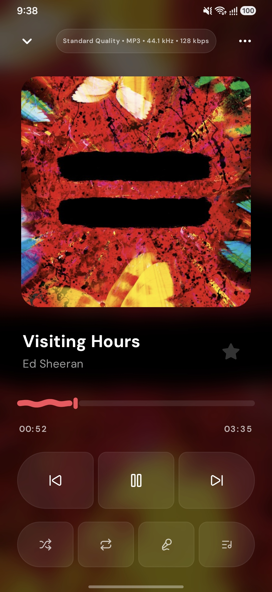
  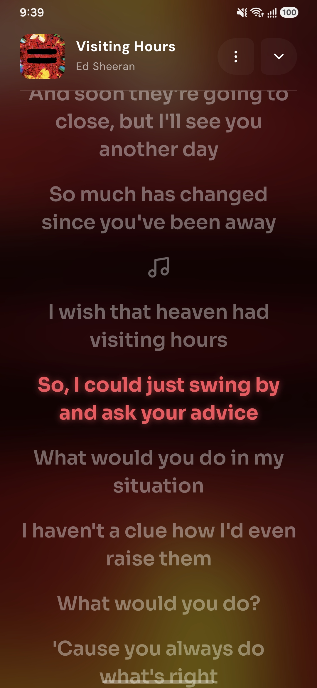
  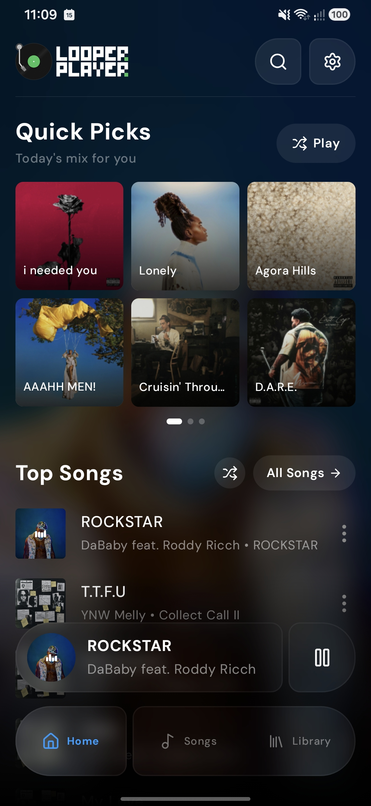
</p>

### 📚 Home Dashboard, Library & Settings
<p align="center">
  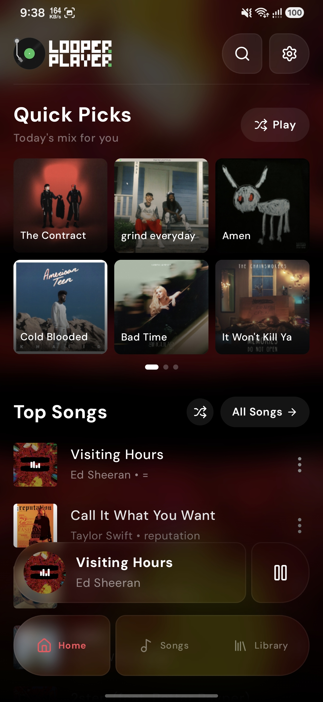
  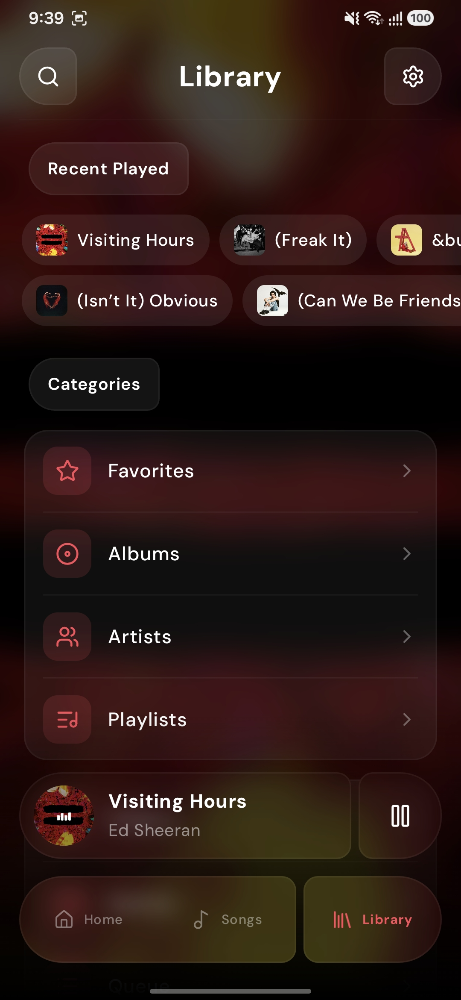
  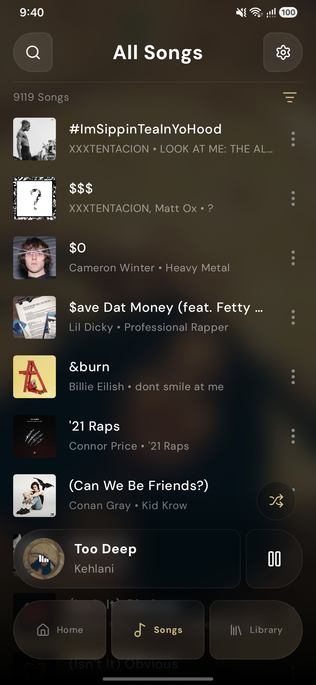
</p>

### 🧩 Interactive AndroidX Glance Widgets
<p align="center">
  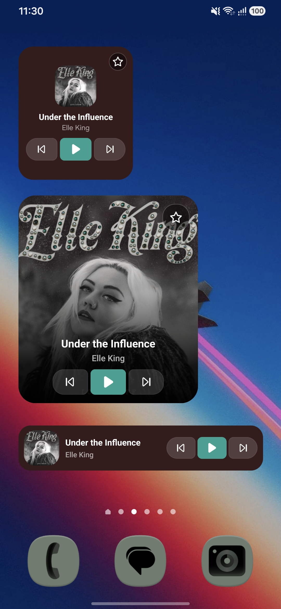
  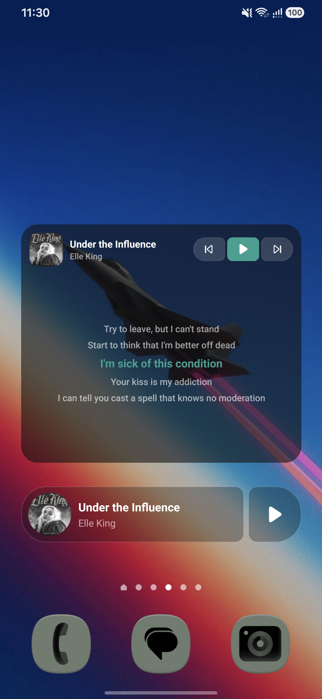
  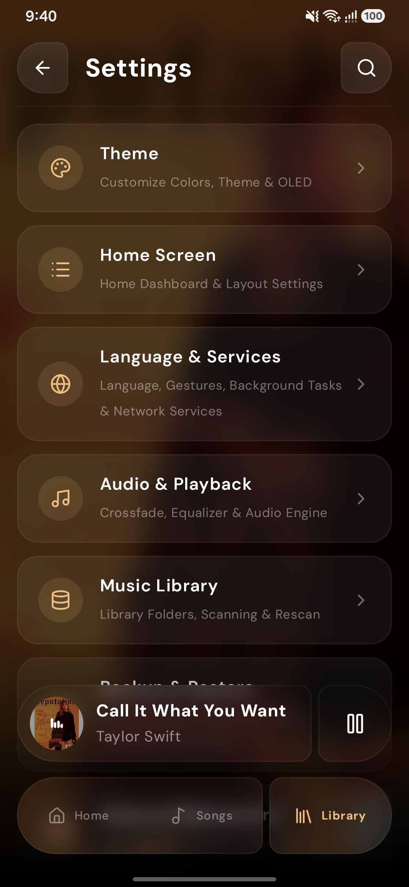
</p>

---

## 🛠️ Tech Stack & Architecture

```
┌────────────────────────────────────────────────────────┐
│               LOOPER ANDROID ARCHITECTURE              │
├────────────────────────────────────────────────────────┤
│  Language           │  Kotlin 2.0+                     │
│  UI Toolkit         │  Jetpack Compose + Material 3    │
│  AppWidgets         │  AndroidX Glance                 │
│  Audio Engine       │  AndroidX Media3 (ExoPlayer)     │
│  Dependency Inject. │  Dagger Hilt                     │
│  Local Database     │  Room SQLite + Flow              │
│  Image Loading      │  Coil 3 + ContentResolver Thumb  │
│  Target SDK         │  Android 15 (API 36)             │
│  Minimum SDK        │  Android 7.0 (API 24)            │
└────────────────────────────────────────────────────────┘
```

- **MVI / Clean Architecture**: Reactive unidirectional data flow using Kotlin `StateFlow`, `SharedFlow`, and coroutines.
- **Scoped Storage & MediaStore**: Compliant with Android 10+ (`Q`) through Android 15 (`VanillaIceCream`) storage standards with high-speed thumbnail caching.
- **ProGuard / R8 Optimization**: Release builds include bytecode shrinking, resource stripping, and log de-bloating for maximum performance (~8 MB standalone APK).

---

## 📦 Download & Installation

Grab the latest Beta build from the [Releases](https://github.com/mikiyasmechalo/looper-android/releases) tab.

1. Download the APK compatible with your device.
2. Open the downloaded APK on your Android device and confirm installation.
   > *Note: If prompted, enable "Install unknown apps" for your browser or file manager.*
3. Enjoy your music offline with zero setup required!

---

## 💻 Building from Source

### Prerequisites
- **JDK 17** (Temurin or OpenJDK recommended)
- **Android Studio** (Ladybug | 2024.2.1+ recommended)
- **Android SDK** API 36 with Build-Tools 36.0.0

### Build Steps
```bash
# Clone the repository
git clone https://github.com/mikiyasmechalo/looper-android.git
cd looper-android

# Build Debug APK
./gradlew assembleDebug

# Build Release APK and Android App Bundle (.aab)
./gradlew assembleRelease bundleRelease
```

The output artifacts will be located in:
- APK: `app/build/outputs/apk/release/app-release.apk`
- AAB: `app/build/outputs/bundle/release/app-release.aab`

---

## 👥 Contributors & Open Source

Looper for Android is brought to you by the collaborative open-source community:

### Native Android Port
* **Mikiyas Mechalo** — *Android Lead Developer & Jetpack Compose Architect*  
  [](https://github.com/mikiyasmechalo)
  [](https://t.me/mikeme2)

### Original Looper Team
* **Nilesh Suthar** — *Original Creator, Architect & Maintainer*  
  [](https://github.com/SthrNilshaaa)
  [](https://t.me/neelshy)
* **Karan Suthar (Krn.)** — *Creative UI/UX & Interaction Designer*  
  [](https://github.com/sthrkaran)
  [](https://t.me/karanwhy)
* **Madan Suthar** — *Active Contributor*  
  [](https://t.me/madansthr)

---

## 📄 License

This project is licensed under the **GPL-3.0 License**. See [LICENSE](LICENSE) for details.
